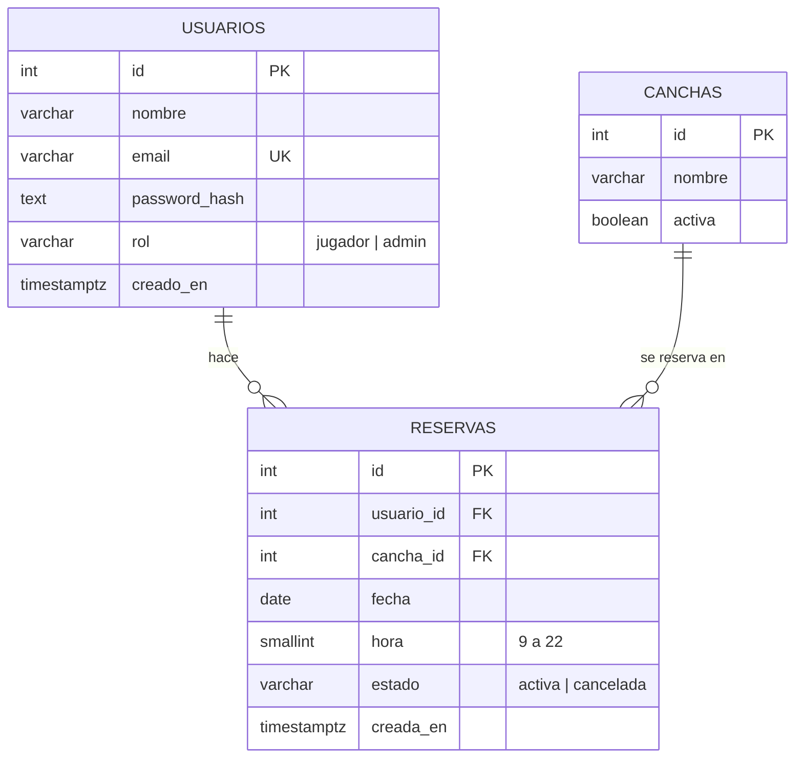

# Relevamiento del proyecto — CanchaYa

## 1. Resumen ejecutivo

CanchaYa es una aplicación web para reservar canchas de pádel de un club. Reemplaza la gestión de turnos por mensajes o planillas por un sistema donde cada jugador ve en tiempo real qué horarios están libres, reserva y cancela por su cuenta, y donde el sistema hace cumplir las reglas del club (sin turnos duplicados, límites por jugador, plazos de cancelación). El club administra sus canchas y consulta todas las reservas desde la misma aplicación.

| Dato | Valor |
|---|---|
| Nombre | CanchaYa |
| Tipo | Aplicación web (frontend + API + base de datos) |
| Usuarios | Jugadores y administrador del club |
| Tecnologías | HTML, CSS y JavaScript (frontend); Node.js 22 (backend); PostgreSQL (base de datos) |
| Despliegue previsto | Netlify (frontend), Render (backend), Neon (base de datos) |
| Repositorio | Ver `README.md` |

## 2. Contexto y problema

### 2.1 Situación que se quiere mejorar

Este relevamiento parte de un escenario típico de club de pádel de barrio. Es un **supuesto de trabajo**: no se hicieron entrevistas a un club real, y si se contara con ellas habría que ajustar esta sección.

Escenario supuesto: los turnos se piden por mensajes de chat o por teléfono, y una persona del club los anota en una planilla o cuaderno.

### 2.2 Problemas identificados

| # | Problema | Consecuencia |
|---|---|---|
| P1 | Dos personas piden el mismo horario casi a la vez y la anotación es manual | Turnos duplicados y discusiones en la cancha |
| P2 | Para saber qué horarios hay libres hay que preguntar | Se pierden reservas fuera del horario de atención |
| P3 | Una misma persona acapara muchos turnos | Menos disponibilidad para el resto |
| P4 | Las cancelaciones de último momento no se pueden volver a ofrecer | Turnos vacíos y pérdida de ingresos |
| P5 | No hay un registro ordenado de quién reservó qué | Es difícil resolver reclamos |

### 2.3 Objetivo general

Construir una aplicación web que permita reservar y cancelar turnos de canchas de forma autónoma, aplicando automáticamente las reglas de negocio del club.

### 2.4 Objetivos específicos

1. Evitar por diseño los turnos duplicados (P1), incluso cuando dos pedidos llegan al mismo tiempo.
2. Mostrar la disponibilidad en cualquier momento, sin intervención del club (P2).
3. Limitar la cantidad de reservas activas por jugador (P3).
4. Liberar el turno apenas se cancela, con un plazo mínimo de aviso (P4).
5. Guardar un registro de todas las reservas consultable por el administrador (P5).

## 3. Alcance

### 3.1 Dentro del alcance (versión 1)

- Registro e inicio de sesión de jugadores.
- Consulta de canchas y de disponibilidad por fecha.
- Reserva y cancelación de turnos de una hora.
- Listado de reservas propias.
- Administración de canchas (crear, activar, desactivar) y listado de todas las reservas.
- Frontend responsive publicado en internet, junto con el backend y la base de datos.

### 3.2 Fuera del alcance (versión 1)

Pagos o señas, recordatorios por email o mensaje, recuperación de contraseña, verificación de email, reservas de varios turnos seguidos, varios clubes, horarios distintos por cancha y reportes o estadísticas.

## 4. Actores y usuarios

| Actor | Descripción | Qué puede hacer |
|---|---|---|
| Visitante | Persona sin sesión iniciada | Registrarse e iniciar sesión |
| Jugador | Usuario registrado (rol `jugador`) | Ver canchas activas, consultar disponibilidad, reservar, ver y cancelar sus reservas |
| Administrador | Personal del club (rol `admin`) | Todo lo del jugador, más: crear y activar o desactivar canchas, ver todas las reservas y cancelar cualquiera |

El administrador inicial se crea al iniciar el backend a partir de las variables de entorno `ADMIN_EMAIL` y `ADMIN_PASSWORD`. Nadie puede volverse administrador desde la pantalla de registro.

## 5. Requerimientos funcionales

| Código | Requerimiento | Actor | Reglas de negocio |
|---|---|---|---|
| RF-01 | Registrarse con nombre, email y contraseña | Visitante | RN-01 |
| RF-02 | Iniciar sesión y mantener la sesión por 8 horas | Visitante | RN-02 |
| RF-03 | Cerrar sesión | Jugador, admin | — |
| RF-04 | Listar las canchas (los jugadores solo ven las activas) | Jugador, admin | RN-12 |
| RF-05 | Consultar la disponibilidad de una cancha en una fecha | Jugador, admin | RN-13 |
| RF-06 | Reservar un turno de una hora | Jugador, admin | RN-03 a RN-08, RN-12 |
| RF-07 | Ver las reservas propias | Jugador, admin | RN-14 |
| RF-08 | Cancelar una reserva propia | Jugador, admin | RN-09, RN-10, RN-11 |
| RF-09 | Crear una cancha | Admin | RN-12 |
| RF-10 | Activar o desactivar una cancha | Admin | RN-12 |
| RF-11 | Ver todas las reservas del club | Admin | RN-14 |
| RF-12 | Cancelar la reserva de cualquier jugador | Admin | RN-09, RN-10, RN-11 |

## 6. Reglas de negocio

Las 14 reglas (RN-01 a RN-14) están redactadas en [`SPEC.md`](SPEC.md), que es la fuente de verdad. Resumen:

| Regla | Resumen |
|---|---|
| RN-01 | Registro: nombre de 2 a 60 caracteres, email válido y único, contraseña de 8 o más |
| RN-02 | Sesión por token de 8 horas; sin sesión, las rutas protegidas devuelven 401 |
| RN-03 | Turnos de 60 minutos, de 09:00 a 22:00 de inicio |
| RN-04 | Una cancha no admite dos reservas activas en el mismo turno |
| RN-05 | No se reservan turnos que ya empezaron o pasaron |
| RN-06 | Anticipación máxima de 14 días |
| RN-07 | Máximo 3 reservas activas futuras por jugador |
| RN-08 | Un jugador no puede tener dos reservas en el mismo horario |
| RN-09 | Cancelación hasta 2 horas antes del turno |
| RN-10 | Solo el dueño de la reserva o un admin puede cancelar |
| RN-11 | Cancelar libera el turno; no se cancela dos veces |
| RN-12 | Solo el admin gestiona canchas; las desactivadas no admiten reservas nuevas |
| RN-13 | La disponibilidad muestra cada turno como libre, ocupado o pasado |
| RN-14 | El jugador solo ve sus reservas; el admin ve todas |

## 7. Requerimientos no funcionales

| Categoría | Requerimiento | Cómo se cumple |
|---|---|---|
| Seguridad | Las contraseñas no se guardan en texto plano | Hash con scrypt y sal aleatoria |
| Seguridad | Las sesiones no se pueden falsificar | Tokens firmados con HMAC-SHA256 que vencen a las 8 h |
| Seguridad | Protección contra inyección SQL | Todas las consultas usan parámetros |
| Seguridad | Protección de los secretos | Variables de entorno; `.env` fuera del repositorio |
| Seguridad | Protección contra cuerpos de petición gigantes | Límite de 100 KB (respuesta 413) |
| Seguridad | Los permisos se validan en el servidor | Las reglas viven en la capa de servicios; el frontend solo muestra |
| Integridad | Nunca debe haber dos reservas activas en el mismo turno | Verificación en el servicio y además índice único parcial en la base de datos |
| Usabilidad | Se usa desde el celular y desde la computadora | Diseño responsive; mensajes de error en español con el número de regla |
| Mantenibilidad | Las reglas se pueden cambiar sin tocar HTTP ni SQL | Arquitectura en capas (http, servicios, repositorios) |
| Calidad | Cada regla está verificada | 53 tests automáticos; cada regla tiene al menos un test que la cita |
| Portabilidad | Se puede levantar sin base de datos para desarrollo | Repositorio en memoria intercambiable con el de PostgreSQL |
| Zona horaria | Los horarios son los de Buenos Aires | Se calcula siempre con UTC-3 (sin horario de verano), probado en `tiempo.test.js` |
| Disponibilidad | El servicio debe estar accesible por internet | Despliegue en Render, Netlify y Neon (pendiente de completar) |

No se establecieron metas numéricas de rendimiento (por ejemplo, tiempos de respuesta) y por eso tampoco se midieron.

## 8. Casos de uso

### CU-01 Registrarse
- **Actor:** Visitante.
- **Flujo principal:** 1) abre la aplicación; 2) elige "Registrarme"; 3) completa nombre, email y contraseña; 4) el sistema crea la cuenta, inicia la sesión y muestra la pantalla de reservas.
- **Alternativos:** email ya registrado (409, RN-01); datos inválidos (400, RN-01).

### CU-02 Iniciar sesión
- **Actor:** Visitante.
- **Flujo principal:** ingresa email y contraseña; el sistema valida y abre la sesión.
- **Alternativos:** credenciales incorrectas (401, el mensaje no indica cuál dato falló, RN-02).

### CU-03 Consultar disponibilidad
- **Actor:** Jugador o admin.
- **Precondición:** sesión iniciada.
- **Flujo principal:** elige cancha y fecha; el sistema muestra los 14 turnos del día como libres, ocupados o pasados.

### CU-04 Reservar un turno
- **Actor:** Jugador o admin.
- **Flujo principal:** 1) consulta la disponibilidad; 2) toca un turno libre; 3) confirma; 4) el sistema registra la reserva y el turno pasa a "Ocupado".
- **Alternativos:** turno ocupado (409, RN-04); turno pasado (422, RN-05); más de 14 días (422, RN-06); ya tiene 3 reservas activas (422, RN-07); ya tiene otra reserva en ese horario (409, RN-08); cancha desactivada (422, RN-12).

### CU-05 Ver mis reservas
- **Actor:** Jugador o admin.
- **Flujo principal:** abre "Mis reservas"; el sistema lista sus reservas ordenadas por fecha y hora, con su estado.

### CU-06 Cancelar una reserva
- **Actor:** Jugador (dueño) o admin.
- **Flujo principal:** elige "Cancelar" en una reserva activa y confirma; el sistema la marca como cancelada y libera el turno.
- **Alternativos:** faltan menos de 2 horas (422, RN-09; el botón no se muestra); reserva ajena (403, RN-10); ya cancelada (409, RN-11).

### CU-07 Gestionar canchas
- **Actor:** Admin.
- **Flujo principal:** en "Administración" crea una cancha con un nombre o activa y desactiva una existente.
- **Alternativos:** un jugador que llama a estas rutas recibe 403 (RN-12).

### CU-08 Ver todas las reservas
- **Actor:** Admin.
- **Flujo principal:** en "Administración" ve la lista de todas las reservas del club y puede cancelar cualquiera.

## 9. Modelo de datos



Restricciones destacadas (ver `db/schema.sql`):
- `usuarios.email` es único y se guarda en minúsculas.
- `reservas.hora` solo admite valores de 9 a 22 y `estado` solo `activa` o `cancelada`.
- Índice único parcial `(cancha_id, fecha, hora)` donde `estado = 'activa'`: garantiza RN-04 aunque dos pedidos lleguen a la vez.

## 10. Arquitectura

```
Navegador (frontend estático en Netlify)
        │  HTTPS, JSON, token en el encabezado Authorization
        ▼
API en Node.js (Render)
   ├─ src/http/          rutas, CORS, límite de cuerpo, manejo de errores
   ├─ src/services/      reglas de negocio RN-01 a RN-14
   ├─ src/repositories/  acceso a datos (memoria o PostgreSQL)
   └─ src/lib/           errores, tiempo, contraseñas y tokens
        │  SQL con parámetros
        ▼
PostgreSQL (Neon)
```

Decisiones de diseño y su razón:

| Decisión | Razón |
|---|---|
| Capas http, servicios y repositorios | Cada una tiene una sola responsabilidad: las reglas se pueden probar sin servidor ni base de datos |
| Repositorio en memoria además del de PostgreSQL | Permite correr los 53 tests en segundos y sin infraestructura |
| La hora actual se pasa como parámetro a las reglas | Los tests son repetibles: no dependen del día en que se ejecutan |
| Backend sin frameworks y con una sola dependencia (`pg`) | Menos superficie de ataque y menos cosas que mantener |
| Contraseñas y tokens con el módulo `crypto` de Node | No hace falta instalar librerías externas |
| Frontend sin build ni framework | Se publica tal cual en Netlify |
| Restricción única en la base además de la regla en el servicio | Cubre la condición de carrera (dos pedidos simultáneos) |

## 11. Interfaces (resumen)

La lista completa de endpoints, con ejemplos, está en [`MANUAL_TECNICO.md`](MANUAL_TECNICO.md). Pantallas del frontend:

| Pantalla | Quién la ve | Para qué sirve |
|---|---|---|
| Acceso (Ingresar / Registrarme) | Visitante | Crear cuenta o iniciar sesión |
| Reservar | Jugador, admin | Elegir cancha y fecha, ver turnos y reservar |
| Mis reservas | Jugador, admin | Ver y cancelar reservas propias |
| Administración | Admin | Gestionar canchas y ver todas las reservas |

## 12. Riesgos, limitaciones y supuestos

### 12.1 Riesgos y limitaciones conocidas

| # | Riesgo o limitación | Impacto | Mitigación o mejora futura |
|---|---|---|---|
| L1 | No hay límite de intentos de login | Posible fuerza bruta de contraseñas | Agregar limitación de intentos por IP o por cuenta |
| L2 | No hay recuperación de contraseña ni verificación de email | Quien olvida su contraseña no puede recuperarla solo | Flujo de recuperación por email |
| L3 | El token se guarda en `localStorage` | Si hubiera una vulnerabilidad XSS, se podría robar | El frontend nunca inserta HTML (usa texto); a futuro, cookies `HttpOnly` |
| L4 | El plan gratuito de Render "duerme" el servicio | La primera petición tras un rato de inactividad tarda hasta ~1 minuto | Plan pago o un servicio que mantenga activo el backend |
| L5 | `CORS_ORIGIN` es `*` por defecto | Cualquier sitio podría llamar a la API desde un navegador | En producción, configurarlo con la URL exacta del frontend (está en la guía de despliegue) |
| L6 | Los listados no tienen paginación | Con muchos miles de reservas el listado del admin sería lento | Paginar y filtrar por fecha |
| L7 | El horario del club es fijo (09:00 a 23:00) para todas las canchas | No se pueden cargar horarios especiales ni feriados | Horarios configurables por cancha |
| L8 | Si el administrador olvida su contraseña, hay que cambiarla directamente en la base | Tarea manual | Pantalla para cambiar la contraseña |
| L9 | No hay registro de auditoría de acciones | No se sabe quién canceló una reserva de otro | Tabla de auditoría |

### 12.2 Supuestos

- El club opera todos los días de 09:00 a 23:00 con turnos de una hora.
- Hay conexión a internet tanto del lado del club como de los jugadores.
- Las reglas numéricas (3 reservas, 14 días, 2 horas) son valores de ejemplo razonables para un club chico y se pueden cambiar en las constantes de `src/services/reservas.js`.

## 13. Trazabilidad

| Requerimiento | Reglas | Endpoint | Pantalla | Tests |
|---|---|---|---|---|
| RF-01 | RN-01 | `POST /api/auth/registro` | Acceso | `auth.test.js`, `api.test.js` |
| RF-02 | RN-02 | `POST /api/auth/login`, `GET /api/me` | Acceso | `auth.test.js`, `api.test.js` |
| RF-03 | — | (se borra el token en el navegador) | Barra superior | Prueba manual M-04, M-14 |
| RF-04 | RN-12 | `GET /api/canchas` | Reservar | `canchas.test.js`, `api.test.js` |
| RF-05 | RN-13 | `GET /api/canchas/:id/disponibilidad` | Reservar | `canchas.test.js`, `api.test.js` |
| RF-06 | RN-03 a RN-08, RN-12 | `POST /api/reservas` | Reservar | `reservar.test.js`, `api.test.js` |
| RF-07 | RN-14 | `GET /api/reservas/mias` | Mis reservas | `cancelar.test.js`, `api.test.js` |
| RF-08 | RN-09 a RN-11 | `POST /api/reservas/:id/cancelar` | Mis reservas | `cancelar.test.js`, `api.test.js` |
| RF-09 | RN-12 | `POST /api/canchas` | Administración | `canchas.test.js`, `api.test.js` |
| RF-10 | RN-12 | `PATCH /api/canchas/:id` | Administración | `canchas.test.js`, `api.test.js` |
| RF-11 | RN-14 | `GET /api/reservas` | Administración | `cancelar.test.js`, `api.test.js` |
| RF-12 | RN-09 a RN-11 | `POST /api/reservas/:id/cancelar` | Administración | `cancelar.test.js` |

## 14. Documentación del proyecto

| Documento | Para quién | Contenido |
|---|---|---|
| `docs/RELEVAMIENTO.md` | Evaluadores, club | Este documento |
| `docs/SPEC.md` | Equipo de desarrollo | Reglas de negocio numeradas |
| `docs/MANUAL_DE_USUARIO.md` | Jugadores | Cómo registrarse, reservar y cancelar |
| `docs/MANUAL_DEL_ADMINISTRADOR.md` | Personal del club | Cómo administrar canchas y reservas |
| `docs/MANUAL_TECNICO.md` | Desarrolladores | Instalación, API, despliegue, mantenimiento |
| `docs/PLAN.md` | Equipo de desarrollo | Tareas y checklist de entrega |
| `docs/INFORME_DE_PRUEBAS.md` | Evaluadores | Resultados de los tests |
| `docs/DEPLOY.md` | Quien publique el sistema | Guía de despliegue |
| `AGENTS.md` | Agentes de IA | Reglas de trabajo en el repositorio |
